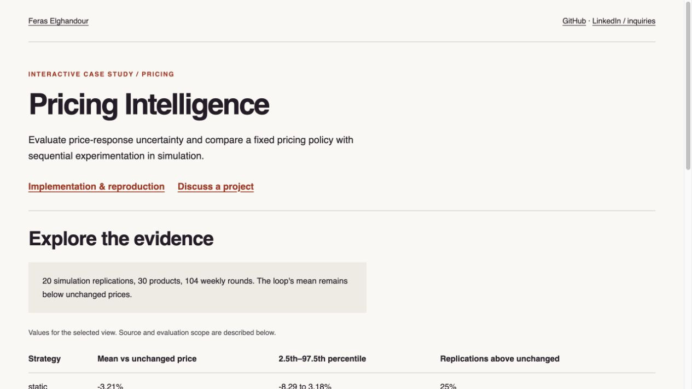
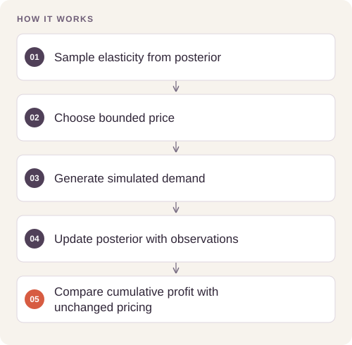

# Pricing Intelligence and Sequential Experimentation

**Feras Elghandour**

Assess whether transaction history supports useful price decisions, then compare static and sequential pricing strategies under explicit simulation assumptions.

**[Explore the evidence report](https://feraselghandour.github.io/pricing-intelligence/)** · [Simulation record](artifacts/loop_metrics.json) · [Elasticity analysis](artifacts/elasticity_findings.json) · [Operating scope](OPERATIONS.md)

[](https://feraselghandour.github.io/pricing-intelligence/)

## How it works




## Reproduce and inspect

The executable reproduction profile now records exact commands, input/source hashes, dependency versions, logs and pass/fail status. Its scope distinguishes behavior checks from full-data benchmarks.

[Commands, artifacts and benchmark scope](BENCHMARKS.md) · [Versioned profiles](reproduction.json)


## Try a small example

A seeded simulated SKU exercises posterior updates. Its invented demand response is not evidence of real-store profit improvement; compare the full recorded experiment with the unchanged-price baseline.

After the local setup below, run from the repository root:

```sh
python examples/quickstart.py
```

The [example source](examples/quickstart.py), [captured output](examples/expected-output.txt) and [execution record](examples/environment.json) keep this demonstration inspectable. Floating-point values may vary with library versions.

Observed output from this run:

```text
{
  "fixture": "synthetic 8-round market, no historical benchmark",
  "first": {
    "round": 1.0,
    "e_hat": -0.6192384149072172,
    "e_sd": 0.6052377665265344,
    "e_true": -2.5,
    "price_loop": 11.5,
    "price_oracle": 11.666666666666666,
    "cum_status_quo": 42.0,
    "cum_static": 55.0,
    "cum_loop": 58.5,
    "cum_oracle": 65.33333333333333
  },
  "last": {
    "round": 8.0,
    "e_hat": -0.6727231162150673,
    "e_sd": 0.5597248183746169,
    "e_true": -2.5,
    "price_loop": 12.5,
    "price_oracle": 11.666666666666666,
    "cum_status_quo": 465.0,
    "cum_static": 462.0,
    "cum_loop": 528.5,
    "cum_oracle": 438.66666666666663
  }
}
```

## Problem and implementation

Historical prices can move with demand conditions, making an observed price-sales association unreliable as a causal elasticity estimate. Sparse product sales also limit the information available for experimentation.

The implementation analyzes a transaction panel, compares elasticity baselines, withholds unsupported recommendations, and simulates sequential price experiments with updating beliefs and bounded price changes.

## Recorded findings

| Strategy | Mean margin vs unchanged prices |
|---|---:|
| Static estimated-price policy | −3.21% |
| Sequential experiment loop | −0.52% |
| Oracle with true simulated demand response | +10.24% |

The saved loop experiment contains **20 simulation replications**, 30 products and 104 weekly rounds. The loop improves on static by **2.69 percentage points on average** and wins the pairwise comparison in **20/20** recorded replications. It remains below unchanged pricing on average. The former “100/100” wording confused a percentage with the replication count and is corrected here.

An exploratory price-traffic association is consistent with confounding; it does not by itself prove a causal mechanism. Counterfactual demand at unobserved prices is simulated. The oracle has information the deployable policies do not possess. No real price experiment or client margin improvement is claimed.

## Reproduce

```sh
python -m venv .venv
. .venv/bin/activate
python -m pip install -r requirements.txt
python run.py
```

The original transaction input is acquired separately as described by the source loader. Use `python build_report.py` to rebuild the public report from retained aggregate findings. The report requires no server-side runtime and publishes no customer-level records.

## Practical relevance and operating limits

The project shows when to withhold a pricing recommendation and how to compare an experiment policy with an unchanged-price baseline. Deployment requires randomized testing with suitable volume, a justified causal design, approved constraints, monitored margin outcomes, and rollback. The public edition is an analysis and simulation, not an autonomous live-pricing service.

[Portfolio](https://feraselghandour.github.io/) · [Professional inquiries](https://www.linkedin.com/in/feras-elghandour/)
